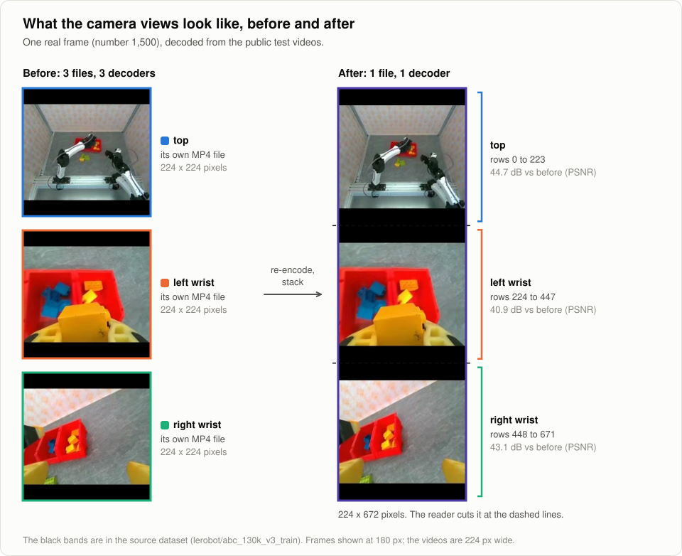
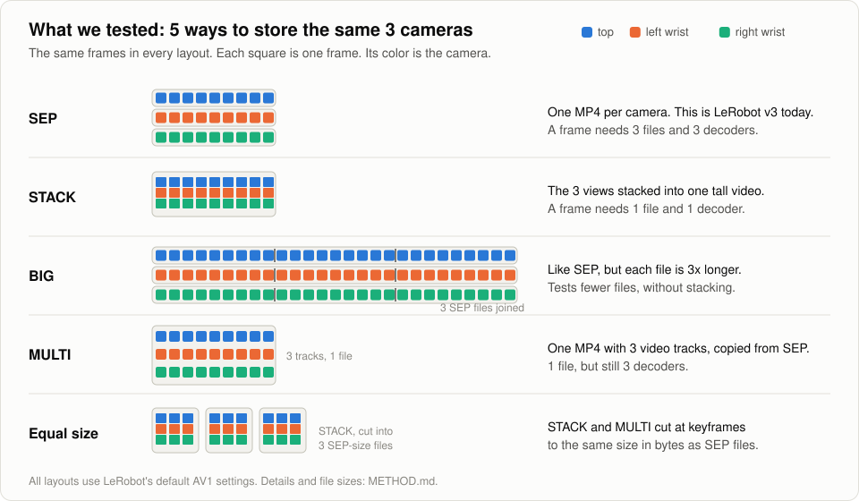
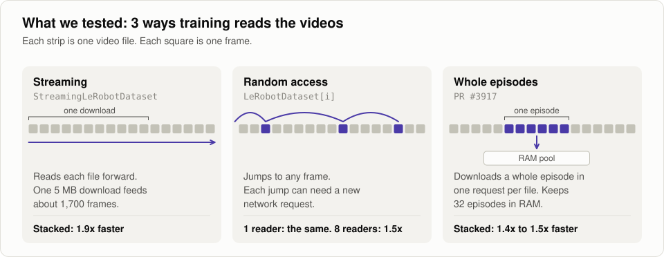
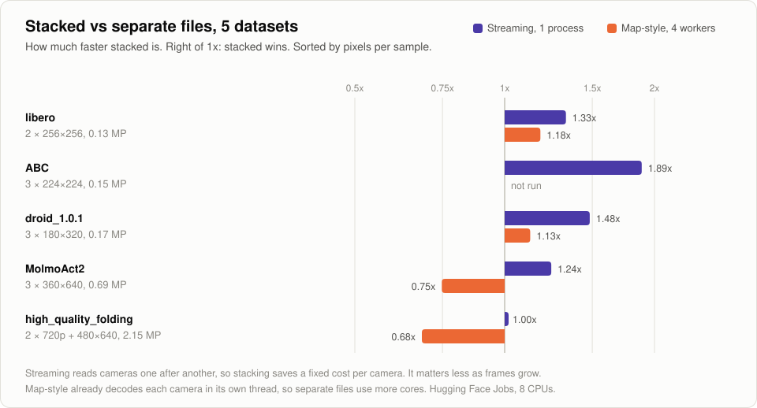
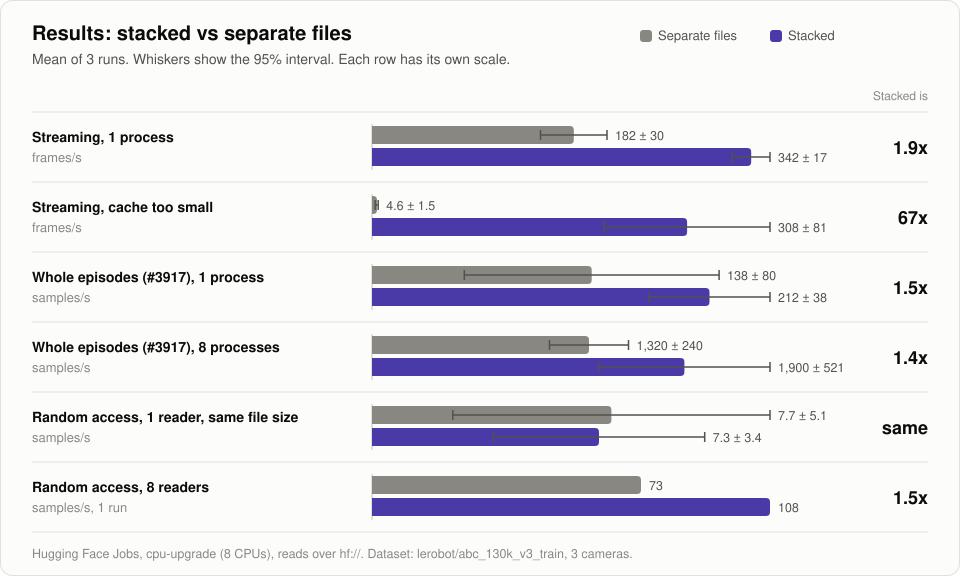
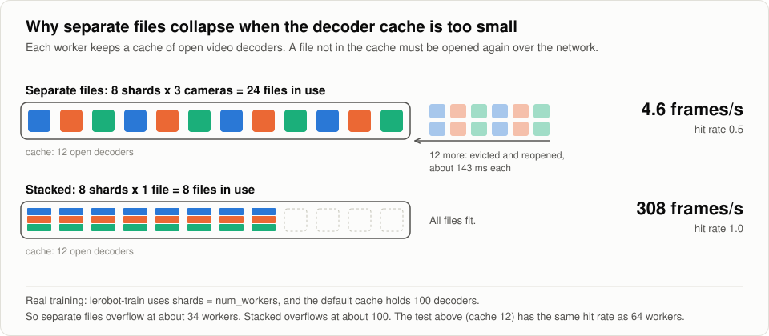

# Stacking camera views: a LeRobot benchmark

This repo tests one idea from the LeRobot roadmap ([#3832](https://github.com/huggingface/lerobot/issues/3832), items DATA-11 and DATA-03):

> Put the 3 camera views of a robot in **one** video file (stacked into one tall image) instead of **3** files. Does training read data faster?

<picture>
  <source media="(prefers-color-scheme: dark)" srcset="docs/figures/loading-dark.svg">
  
</picture>

The animation shows streaming on ABC, the dataset where stacking helps most. The bars use the measured CPU time per frame.

## Answer

**It depends on frame size and on how training reads data.** We tested 5 datasets.

- **Streaming, small frames: stacked is 1.3x to 1.9x faster.** Streaming decodes the cameras one after another. Each camera read has a fixed cost, and stacking pays it once.
- **Big frames: no gain.** At 720p, decoding the pixels takes almost all the time, so the fixed cost no longer matters (1.00x).
- **Map-style with big frames: stacked is slower (0.68x to 0.75x).** Map-style already decodes each camera in its own thread, so separate files keep more CPU cores busy.
- **Too many open files: stacked avoids a 16x to 90x drop.** When the decoder cache overflows, separate files fall to 3 to 6 frames/s on every dataset. This can also be fixed in the reader, with no format change: size the cache to the number of open files.
- **Training speed: no change at default settings.** On all 5 datasets, one streaming worker with separate files already reads faster than an A100 trains ACT (batch 8). So stacking saves CPU, not training time.

On this evidence, stacking alone does not justify a new dataset format. Its gains are real but small where frames are big, and the largest effect has a reader fix.

## What we tested

Stacking puts the 3 camera images of one moment into one tall image. The reader cuts it back into 3 images.

<picture>
  <source media="(prefers-color-scheme: dark)" srcset="docs/figures/views-dark.svg">
  
</picture>

We stored the same frames in 5 layouts. The main comparison is SEP (today) vs STACK.

<picture>
  <source media="(prefers-color-scheme: dark)" srcset="docs/figures/layouts-dark.svg">
  
</picture>

We read them in the 3 ways training reads videos.

<picture>
  <source media="(prefers-color-scheme: dark)" srcset="docs/figures/read-modes-dark.svg">
  
</picture>

## Results across 5 datasets

<picture>
  <source media="(prefers-color-scheme: dark)" srcset="docs/figures/datasets-dark.svg">
  
</picture>

Each job took a slice of 10k to 60k consecutive frames from the real dataset, re-encoded it with LeRobot's default settings, and copied it into 8 files per camera. Streaming reads over `hf://`. Map-style reads local disk with the `lerobot-train` DataLoader settings (batch 8, `EpisodeAwareSampler`, 4 workers). Mean of 5 runs (streaming) or 4 runs (map-style), ± a 95% interval.

| Dataset | Cameras | Streaming, frames/s separate → stacked | Map-style, 4 workers, samples/s separate → stacked | Streaming, cache overflow, frames/s separate → stacked |
|---|---|---|---|---|
| [`lerobot/libero`](https://huggingface.co/datasets/lerobot/libero) | 2 × 256×256 | 368 ± 15 → 488 ± 22 (**1.33x**) | 965 ± 45 → 1139 ± 43 (**1.18x**) | 5.5 → 490 |
| [`lerobot/abc_130k_v3_train`](https://huggingface.co/datasets/lerobot/abc_130k_v3_train) | 3 × 224×224 | 182 ± 30 → 342 ± 17 (**1.9x**) | not run | 4.6 → 308 |
| [`lerobot/droid_1.0.1`](https://huggingface.co/datasets/lerobot/droid_1.0.1) | 3 × 180×320 | 222 ± 7 → 328 ± 23 (**1.48x**) | 764 ± 5 → 860 ± 37 (**1.13x**) | 3.8 → 334 |
| [`allenai/MolmoAct2-BimanualYAM-Dataset`](https://huggingface.co/datasets/allenai/MolmoAct2-BimanualYAM-Dataset) | 3 × 360×640 | 145 ± 10 → 179 ± 13 (**1.24x**) | 511 ± 9 → 382 ± 30 (**0.75x**) | 3.1 → 184 |
| [`lerobot/high_quality_folding`](https://huggingface.co/datasets/lerobot/high_quality_folding) | 2 × 720×1280 + 480×640 | 71 ± 4 → 71 ± 3 (1.00x) | 248 ± 8 → 169 ± 18 (**0.68x**) | 4.6 → 75 |

### Why frame size changes the answer

- **Each camera read has a fixed cost.** In streaming, the CPU time per frame is about `cameras × fixed cost + pixel cost` for separate files and `fixed cost + pixel cost` for stacked. From the measured CPU times, the fixed cost is about 0.4 to 1.3 ms per camera. For libero, the pixel cost is about 1.5 ms per frame, so the fixed cost is a big share. For high_quality_folding, it is about 13 ms, so the fixed cost barely counts.
- **Map-style already reads cameras in parallel.** `LeRobotDataset` decodes each camera in its own thread (`dataset_reader.py`, `ThreadPoolExecutor`). With big frames, 3 threads per sample keep more cores busy than 1 stacked decode. Stacked still uses less CPU per sample (MolmoAct2: 11.5 vs 15.0 ms), so with more workers than cores it could catch up. We did not run that.
- **The cache overflow drop holds everywhere.** With 12 cache slots and 8 files per camera, separate files miss the cache on a quarter to half of the reads, and each miss reopens a file. Stacked needs 2x (libero) or 3x fewer slots and never missed.
- **Random access over a full-size dataset favors stacked on small frames.** We shrank the map-style cache so that it holds the same share of files as a 100-slot cache holds on the full dataset. Stacked then wins on droid (643 vs 255 samples/s, 2.5x) and MolmoAct2 (363 vs 265, 1.4x), but not on high_quality_folding (185 vs 234, 0.79x).

### Does data loading limit training?

We timed one training step on a GPU (synthetic batches, `lerobot-train` defaults, batch 8, no mixed precision). The table shows how many samples per second training uses, next to what one streaming worker reads with separate files.

| Dataset | ACT on A100 uses | ACT on L4 uses | SmolVLA on A100 uses | 1 streaming worker, separate files, reads |
|---|---|---|---|---|
| libero | 194 | 132 | 48 | 368 |
| ABC | 162 | 118 | 46 | 182 |
| droid | 165 | 110 | 48 | 222 |
| MolmoAct2 | 105 | 33 | 43 | 145 |
| high_quality_folding | 34 | 8 | 48 | 71 |

One worker already keeps up, and `lerobot-train` uses 4 by default. So with these policies and GPUs, stacking does not change training time. It frees CPU cores. It would matter with few CPU cores per GPU, faster GPUs, or when the cache overflows.

## Results on ABC in detail

<picture>
  <source media="(prefers-color-scheme: dark)" srcset="docs/figures/results-dark.svg">
  
</picture>

Dataset: [`lerobot/abc_130k_v3_train`](https://huggingface.co/datasets/lerobot/abc_130k_v3_train). It has 3 cameras (top, left wrist, right wrist) and is stored in LeRobot's default format (AV1, a keyframe every 2 frames). All reads go over `hf://` from a Hugging Face Jobs machine (`cpu-upgrade`, 8 CPUs). Each number is the mean of 3 runs, ± a 95% confidence interval.

| How training reads data | Separate files | Stacked | Stacked is |
|---|---|---|---|
| Streaming (`StreamingLeRobotDataset`), 1 process, frames/s | 182 ± 30 | 342 ± 17 | **1.9x faster** |
| Streaming, too many workers for the decoder cache, frames/s | 4.6 ± 1.5 | 308 ± 81 | **67x faster** |
| Whole-episode reads ([#3917](https://github.com/huggingface/lerobot/pull/3917)), 1 process, samples/s | 138 ± 80 | 212 ± 38 | **1.5x faster** |
| Whole-episode reads (#3917), 8 processes, samples/s | 1320 ± 240 | 1900 ± 521 | **1.4x faster** |
| Random access, 1 reader, same file size, samples/s | 7.7 ± 5.1 | 7.3 ± 3.4 | the same |
| Random access, 8 readers, samples/s (1 run) | 73 | 108 | **1.5x faster** |

### Why each row comes out this way

- **Streaming reads each file forward.** One 5 MB download serves about 1,700 frames, so the network costs almost nothing. What is left is decoding, and stacked needs 1 decode call instead of 3.
- **The decoder cache holds 100 open files per worker.** With `lerobot-train`, the busiest worker keeps about `3 × num_workers` files open for separate cameras. Past about 34 workers its cache overflows. Separate files then reopen a file on about half the reads, and speed falls to 4.6 frames/s. Stacked needs 3x fewer open files, so it overflows only past about 100 workers.

  <picture>
    <source media="(prefers-color-scheme: dark)" srcset="docs/figures/cache-dark.svg">
    
  </picture>
- **#3917 downloads one episode per camera in one request.** Both layouts download the same bytes (24 vs 25 MB per episode). Stacked wins on CPU.
- **Random access with 1 reader waits on one request at a time.** Stacked sends 1 request per sample and separate files send 3, but the 3 go out at the same time, so the wait is the same.
- **With 8 readers, the number of requests counts.** Separate files sent 219 requests/s, stacked sent 107.

## What stacking costs

- **Every camera must have the same width and frame rate.** Cameras of different sizes need padding. On high_quality_folding, padding is 12.5% of the stacked frame and the file is 2.5% bigger.
- **The videos must be re-encoded.** Each stacked view loses about as much as a re-encoded separate file: 38 to 44 dB PSNR against the source on average, within 1 dB of separate files.
- **Reading one camera means decoding all of them.** Reading 1 camera from separate files is 1.3x (libero) to 2.7x (high_quality_folding) faster than reading the stacked file.
- **It is a format change.** Old LeRobot versions cannot read it. The reader must crop the views back into `observation.images.*`.

## Limits

- **Runs vary about 2x on the Hub.** The same files gave 6.8 samples/s in one run and 13.6 in another. So we only compare layouts inside the same run.
- All jobs ran inside Hugging Face's network. From a laptop, each request waited about 170 ms instead of about 65 ms. Fewer requests help more there.
- The "too many workers" row uses a small cache (12) with 8 shards. That gives the same hit rate as 64 workers with the default cache of 100.
- The #3917 pool held every episode, so it never had to swap episodes.
- The 8-reader row is a single run.
- Round 4 used one slice per dataset, copied into 8 files. File-to-file variation is not sampled.
- Round 4 map-style reads local disk with a warm page cache. It measures decode CPU, not network reads.
- The streaming rows are one process. The cache overflow rows emulate many workers with a small cache.
- The GPU step times use synthetic batches of the right shapes, 50 steps after 10 warm-up steps. They do not include the DataLoader.

## Next

Round 4 answered the frame size question (see [Results across 5 datasets](#results-across-5-datasets)). Still open:

- Map-style with more workers than CPU cores, to see if stacked catches up on big frames.
- Decoding 3 separate files in one batched call, to get the fixed-cost gain with no format change.

Status updates go on the DATA-11 claim in [#3832](https://github.com/huggingface/lerobot/issues/3832#issuecomment-5823194668).

## Follow-up questions

1. **For the DATA-03 owners:** is stacking planned? If yes, what happens to cameras of different sizes: pad, or refuse to stack?
2. Can a reader get the CPU gain without a format change, by decoding 3 separate files in one batched call?
3. How many workers do large LeRobot training runs use? That decides how often the cache overflows.
4. Should stacking be an option when recording, a conversion tool for existing datasets, or both?
5. With a #3917 pool that swaps episodes, does 1 request per episode instead of 3 matter?

## Not in this report

We also tested faster readers (exact byte ranges, opening files outside the decoder cache lock) and multi-track MP4 files (one file, 3 video tracks). Those results will go in separate issues. One of them needs attention now: on a multi-track file, #3917 returns the first camera for every camera, with no error.

## Files

- [`METHOD.md`](METHOD.md): how we measured, the job ids and the cost.
- [`bench/`](bench/): the code. It runs on Hugging Face Jobs, and one round costs under $0.10. See [`bench/README.md`](bench/README.md).
- [`results/`](results/): summaries and raw numbers for each round. Round 4 (5 datasets and GPU step times) is in [`results/round4/`](results/round4/).
- [`docs/figures/`](docs/figures/): the figures. `make_figures.py` draws them (no dependencies). `grab_views.py` decodes the real frame shown above.
- Test videos: [`hadriencornier/lerobot-camera-stacking-benchmark`](https://huggingface.co/datasets/hadriencornier/lerobot-camera-stacking-benchmark) on the Hub.

Source data: `lerobot/abc_130k_v3_train` (Apache-2.0), from the ABC project ([paper](https://arxiv.org/abs/2606.27375), [code](https://github.com/amazon-far/abc)). Round 4 also read `lerobot/droid_1.0.1`, `allenai/MolmoAct2-BimanualYAM-Dataset`, `lerobot/libero` and `lerobot/high_quality_folding`. This repo holds only numbers from them, no frames. This repo is Apache-2.0.

I used AI (Claude) to help write the code and this text. The numbers come from the jobs listed in `METHOD.md`.
